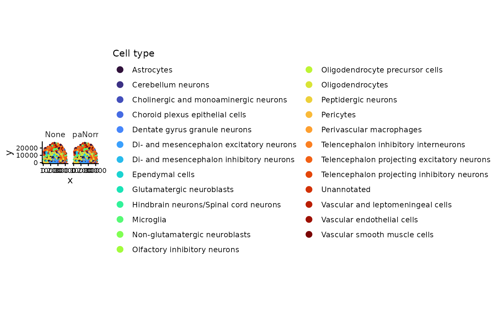
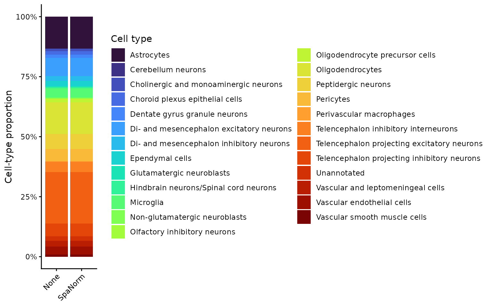
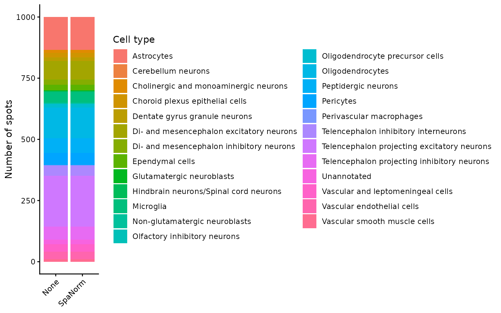
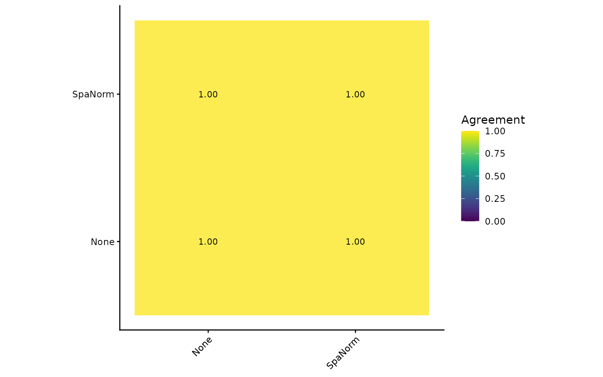
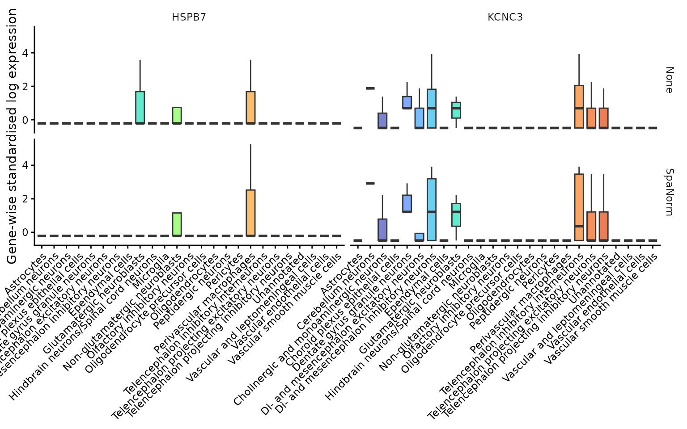
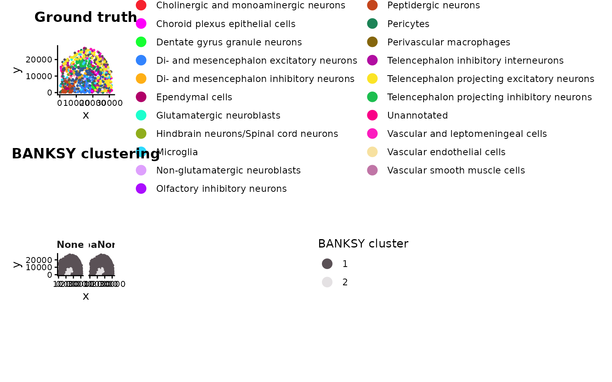
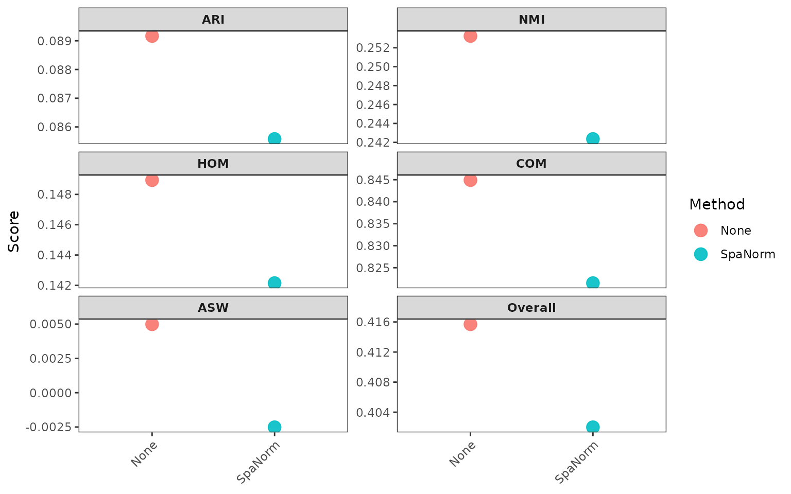
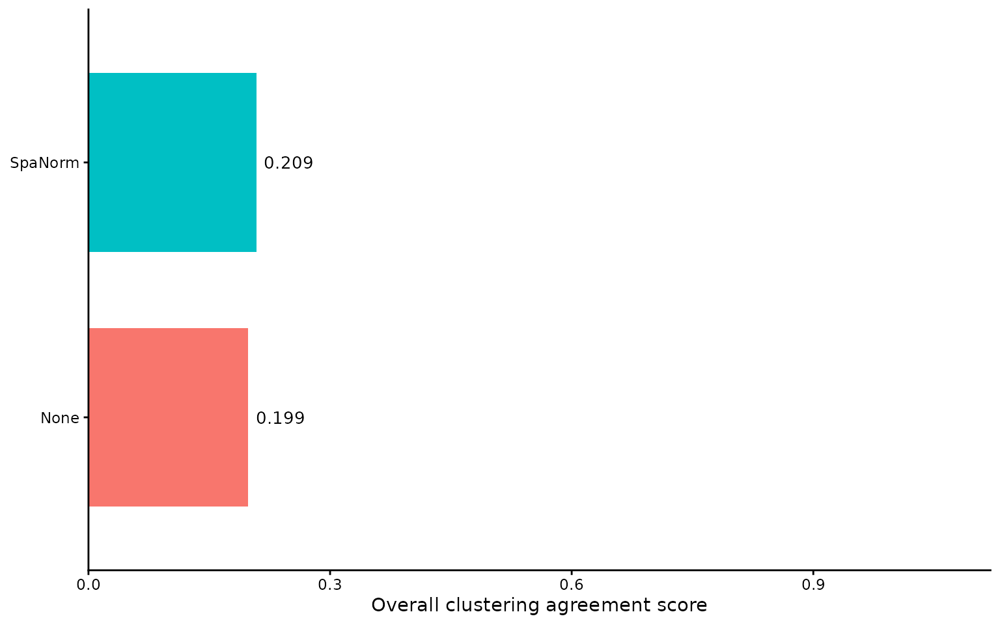
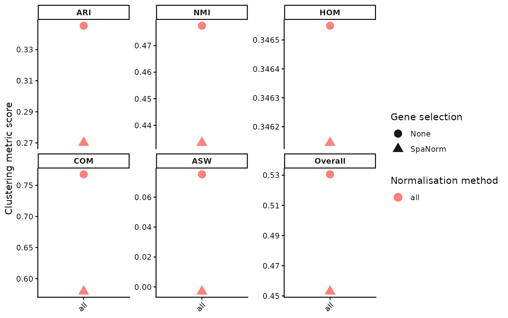

# Cell-type annotation and spatial clustering with STBench

## Introduction

This vignette uses the cell-type labels already supplied in
`norm_example`, so an external SingleR reference is not required.

``` r

data(norm_example)
norm <- norm_example
names(norm)
#> [1] "None"    "SpaNorm"
```

## Cell-type annotation

The example data include existing `cell_type` annotations. We use these
to demonstrate downstream comparisons without requiring an external
SingleR reference. In a full analysis,
[`run_annotation()`](https://lahiru-lsb.github.io/STBench/reference/run_annotation.md)
can be used with an appropriate reference.

``` r

annotated_norm <- norm
annotation_col <- "cell_type"
```

### Visualise spatial cell-type assignments

``` r

p_annotation <- plot_spatial_annotation(
  norm_list = annotated_norm,
  annotation_col = annotation_col,
  method_order = NULL,
  point_size = 0.5,
  ncol = 2,
  theme_name = "classic",
  palette = "turbo"
)
p_annotation$plot
```



### Compare cell-type composition

We examine relative proportions and absolute spot counts assigned to
each cell type.

``` r

p_prop <- plot_celltype_proportion(
  norm_list = annotated_norm,
  annotation_col = annotation_col,
  palette = "turbo",
  show = "proportion",
  theme_name = "classic"
)
p_prop$plot
```



``` r

p_count <- plot_celltype_proportion(
  norm_list = annotated_norm,
  annotation_col = annotation_col,
  show = "count",
  theme_name = "classic"
)
p_count$plot
```



### Calculate and plot annotation agreement

Pairwise agreement measures the fraction of spots receiving the same
label under two methods. It measures consistency, not accuracy against a
known ground truth.

``` r

annotation_agreement <- calculate_annotation_agreement(
  norm_list = annotated_norm,
  annotation_col = annotation_col,
  remove_na = TRUE
)
annotation_agreement
#>   method1 method2 agreement n_compared
#> 1    None SpaNorm         1        944

p_agreement <- plot_annotation_agreement(
  norm_list = annotated_norm,
  annotation_col = annotation_col,
  remove_na = TRUE,
  show_values = TRUE,
  digits = 2,
  colour_option = "viridis",
  theme_name = "classic"
)
p_agreement$plot
```



### Marker investigations

Marker comparisons depend on the presence of biologically relevant
genes. The following code demonstrates how to specify candidate markers
when available.

``` r

p_marker <- plot_marker_expression(
  norm_list = annotated_norm,
  markers = head(rownames(annotated_norm[[1]]), 2),
  annotation_col = "cell_type",
  palette = "turbo"
)
p_marker$plot
```



## BANKSY spatial clustering

BANKSY incorporates spatial neighbourhood information alongside gene
expression to identify spatial domains. We execute clustering on the
small example dataset.

``` r

banksy_norm <- run_banksy_individual(
  norm_list = norm,
  methods = names(norm),
  assay_name = "logcounts",
  cluster_col = "banksy_cluster",
  k_geom = 15,
  lambda = 0.8,
  resolution = 0.2,
  seed = 123
)
```

### Visualise and evaluate BANKSY clusters

These functions operate on the output of
[`run_banksy_individual()`](https://lahiru-lsb.github.io/STBench/reference/run_banksy_individual.md)
above.

``` r

p_banksy <- plot_spatial_clustering(
  norm_list = banksy_norm,
  cluster_col = "banksy_cluster",
  ground_truth_col = "layer_guess",
  show = "both",
  methods = names(banksy_norm),
  point_size = 0.5,
  ncol = 2,
  theme_name = "classic"
)
p_banksy$plot
```



``` r

metrics_df <- calculate_clustering_metrics(
  norm_list = banksy_norm,
  ground_truth_col = "layer_guess",
  cluster_col = "banksy_cluster",
  methods = names(banksy_norm)
)
metrics_df
#>    method  slice   n        ARI       NMI       HOM       COM          ASW
#> 1    None slice1 944 0.08916554 0.2532399 0.1489408 0.8449019  0.004987321
#> 2 SpaNorm slice1 944 0.08558020 0.2423588 0.1421474 0.8215048 -0.002514273
#>     Overall n_asw ASW_sampled
#> 1 0.4156942   944       FALSE
#> 2 0.4020037   944       FALSE

p_metrics <- plot_clustering_metrics(
  metrics_df = metrics_df,
  metrics = c("ARI", "NMI", "HOM", "COM", "ASW", "Overall"),
  ncol = 2,
  scales = "free_y",
  theme_name = "bw"
)
p_metrics$plot
```



``` r

ranking_df <- rank_normalization_methods(metrics_df = metrics_df)
ranking_df
#>   Rank  method   Overall
#> 1    1    None 0.4156942
#> 2    2 SpaNorm 0.4020037

p_ranking <- plot_normalization_ranking(
  ranking_df = ranking_df,
  bar_width = 0.7,
  label_size = 3.5,
  theme_name = "classic"
)
p_ranking$plot
```



### BANKSY with different gene-selection strategies

For a small example dataset, a selection size of 500 can exceed the
number of available genes. For the small dataset, each selection
strategy uses up to the available number of genes.

``` r

data(svg_example)

banksy_genes <- run_banksy_gene_selection(
  norm_list = norm,
  svg_list = svg_example,
  gene_selection = "all",
  assay_name = "logcounts",
  k_geom = 15,
  lambda = 0.8,
  resolution = 0.2,
  seed = 123
)

metrics_genes <- calculate_gene_selection_metrics(
  banksy_list = banksy_genes,
  ground_truth_col = "layer_guess"
)

p_genes <- plot_gene_selection_metrics(
  metrics_df = metrics_genes,
  ncol = 3,
  scales = "free_y",
  theme_name = "classic"
)
p_genes$plot
```



## Session information

``` r

sessionInfo()
#> R version 4.6.2 (2026-10-29)
#> Platform: x86_64-pc-linux-gnu
#> Running under: Ubuntu 26.04.1 LTS
#> 
#> Matrix products: default
#> BLAS:   /usr/lib/x86_64-linux-gnu/openblas-pthread/libblas.so.3 
#> LAPACK: /usr/lib/x86_64-linux-gnu/openblas-pthread/libopenblasp-r0.3.32.so;  LAPACK version 3.12.0
#> 
#> locale:
#>  [1] LC_CTYPE=C.UTF-8       LC_NUMERIC=C           LC_TIME=C.UTF-8       
#>  [4] LC_COLLATE=C.UTF-8     LC_MONETARY=C.UTF-8    LC_MESSAGES=C.UTF-8   
#>  [7] LC_PAPER=C.UTF-8       LC_NAME=C              LC_ADDRESS=C          
#> [10] LC_TELEPHONE=C         LC_MEASUREMENT=C.UTF-8 LC_IDENTIFICATION=C   
#> 
#> time zone: UTC
#> tzcode source: system (glibc)
#> 
#> attached base packages:
#> [1] stats     graphics  grDevices utils     datasets  methods   base     
#> 
#> other attached packages:
#> [1] STBench_0.99.4
#> 
#> loaded via a namespace (and not attached):
#>  [1] tidyselect_1.2.1            viridisLite_0.4.3          
#>  [3] dplyr_1.2.1                 farver_2.1.2               
#>  [5] viridis_0.6.5               S7_1.0.0                   
#>  [7] fastmap_1.2.0               SingleCellExperiment_1.34.0
#>  [9] digest_0.6.39               lifecycle_1.0.5            
#> [11] cluster_2.1.8.3             magrittr_2.0.5             
#> [13] dbscan_1.3.0                compiler_4.6.2             
#> [15] rlang_1.3.0                 sass_0.5.0                 
#> [17] tools_4.6.2                 igraph_2.3.4               
#> [19] yaml_2.3.12                 data.table_1.18.6.1        
#> [21] knitr_1.52                  S4Arrays_1.12.1            
#> [23] labeling_0.4.3              htmlwidgets_1.6.4          
#> [25] mclust_6.1.4                scatterplot3d_0.3-45       
#> [27] DelayedArray_0.38.2         RColorBrewer_1.1-3         
#> [29] abind_1.4-8                 withr_3.0.3                
#> [31] purrr_1.2.2                 BiocGenerics_0.58.1        
#> [33] desc_1.4.3                  grid_4.6.2                 
#> [35] stats4_4.6.2                colorspace_2.1-4           
#> [37] aricode_1.1.0               ggplot2_4.0.4              
#> [39] scales_1.4.0                SummarizedExperiment_1.42.0
#> [41] cli_3.6.6                   rmarkdown_2.32             
#> [43] ragg_1.5.2                  leidenAlg_1.1.8            
#> [45] generics_0.1.4              otel_0.3.0                 
#> [47] rjson_0.2.23                Banksy_1.8.1               
#> [49] cachem_1.1.0                RcppHungarian_0.3          
#> [51] parallel_4.6.2              XVector_0.52.0             
#> [53] matrixStats_1.5.0           vctrs_0.7.3                
#> [55] Matrix_1.7-6                jsonlite_2.0.0             
#> [57] clevr_0.1.2                 patchwork_1.3.2            
#> [59] IRanges_2.46.0              S4Vectors_0.50.3           
#> [61] irlba_2.4.1                 systemfonts_1.3.4          
#> [63] magick_2.9.1                tidyr_1.3.2                
#> [65] jquerylib_0.1.4             glue_1.8.1                 
#> [67] pkgdown_2.2.1               uwot_0.2.5                 
#> [69] Polychrome_1.6.2            gtable_0.3.6               
#> [71] GenomicRanges_1.64.0        tibble_3.3.1               
#> [73] pillar_1.11.1               htmltools_0.5.9            
#> [75] Seqinfo_1.2.0               R6_2.6.1                   
#> [77] textshaping_1.1.0           sparseMatrixStats_1.24.0   
#> [79] evaluate_1.0.5              sccore_1.0.7               
#> [81] lattice_0.23-1              Biobase_2.72.0             
#> [83] SpatialExperiment_1.22.0    bslib_0.12.0               
#> [85] Rcpp_1.1.2                  gridExtra_2.3.1            
#> [87] SparseArray_1.12.3          xfun_0.62                  
#> [89] fs_2.1.0                    MatrixGenerics_1.24.0      
#> [91] pkgconfig_2.0.3
```
