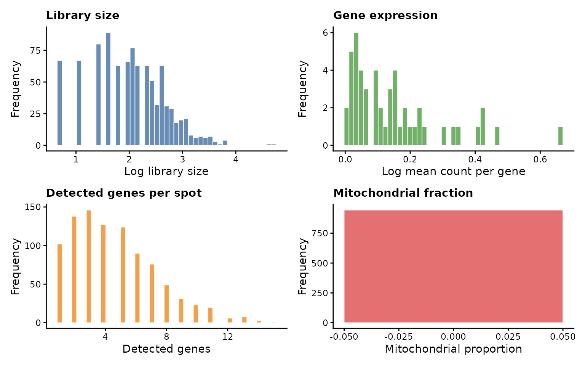
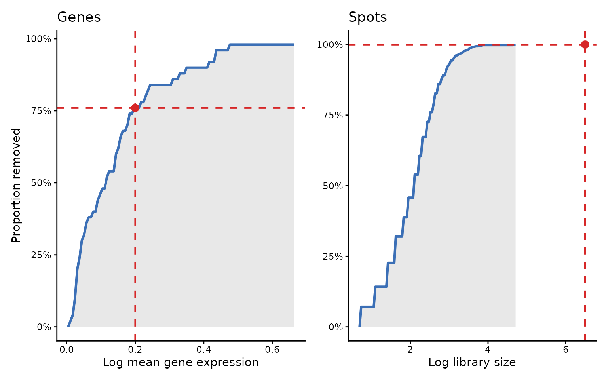
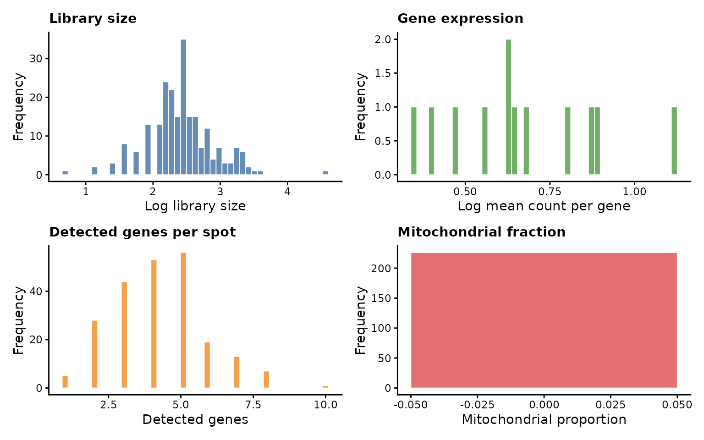
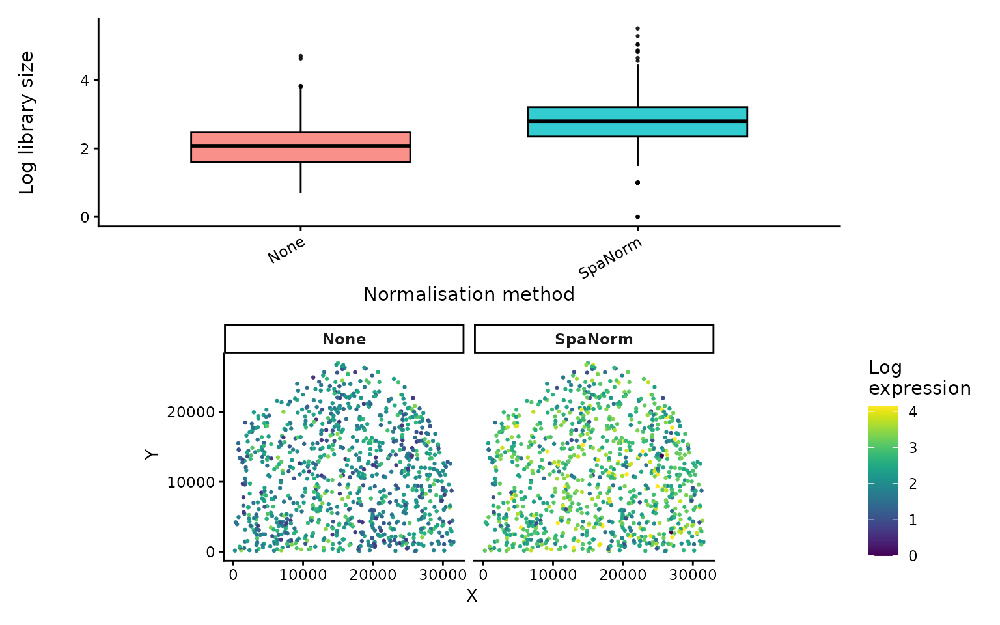
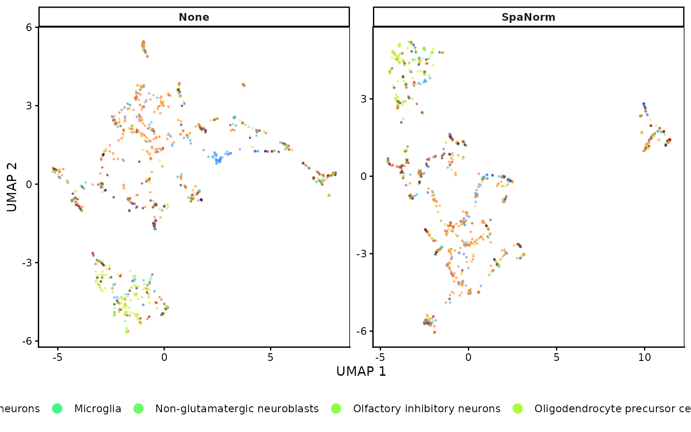

# Getting started with STBench

## Introduction

STBench is an R package for comparing normalisation methods in spatial
transcriptomics.

## Load data

``` r

data(spe_example)
data(norm_example)

dim(spe_example)
#> NULL
names(norm_example)
#> [1] "None"    "SpaNorm"
```

## Quality control

### Calculate and visualise QC metrics

We first calculate spot-level metrics, including library size, detected
genes and mitochondrial fraction, together with gene-level expression
summaries. We inspect their distributions before filtering.

``` r

spe <- add_qcs(
  spe_example,
  assay_name = "counts",
  mito_pattern = "^mt-|^MT-"
)

p_qc <- plot_qc(
  spe,
  bins = 45,
  show_density = TRUE,
  theme_name = "classic"
)
p_qc$plot
```



### Explore filtering thresholds

We examine the relationship between possible cutoffs and the proportions
of spots and genes removed, without performing any filtering. We use
illustrative rather than dataset-specific thresholds.

``` r

p_cutoffs <- plot_qc_cutoffs(
  spe,
  library_cutoff = 6.5,
  gene_cutoff = 0.2,
  n_points = 100,
  theme_name = "classic"
)
p_cutoffs$plot
```



### Apply filtering and reassess QC

We remove spots and genes below the selected thresholds. Choose cutoffs
appropriate to the dataset.

``` r

spe_filtered <- filter_qc(
  spe,
  library_cutoff = 2.5,
  gene_cutoff = 0.2,
  recalculate = TRUE,
  assay_name = "counts",
  mito_pattern = "^mt-|^MT-"
)
plot_qc(spe_filtered, theme_name = "classic")$plot
```



## Apply normalisation methods

The `None` method provides a log1p-transformed baseline. Method-specific
arguments are supplied through `params`. We execute normalisation on the
small dataset; for subsequent comparisons, we use the saved
`norm_example` for a consistent reference.

``` r

norm_recomputed <- normalize_spe(
  spe_example,
  methods = c("None", "SpaNorm"),
  params = list(
    spanorm = list(
      sample_p = 0.15,
      df_tps = 6,
      adj_method = "logpac",
      seed = 123
    )
  )
)
```

``` r

norm <- norm_example
lapply(norm, dim)
#> $None
#> [1]  50 944
#> 
#> $SpaNorm
#> [1]  50 944
```

## Compare normalised library sizes

We compare summed normalised expression across spots. The comparison
uses the normalisation methods in the example dataset.

``` r

p_ls <- plot_library_size_comparison(
  norm,
  methods = names(norm),
  assay_name = "logcounts",
  point_size = 0.5,
  theme_name = "classic"
)
p_ls$plot
```



## UMAP visualisation

We run PCA and UMAP independently for each normalisation method and
colour by the available cell-type annotation.

``` r

umap_data <- get_umap_data(
  norm,
  methods = names(norm),
  prop_spots = 1,
  seed = 123,
  assay_name = "logcounts",
  n_pcs = 10,
  n_neighbors = 15
)
```

``` r

p_umap <- plot_umap_comparison(
  umap_data,
  colour_by = "cell_type",
  point_size = 1,
  alpha = 0.6,
  ncol = 2,
  theme_name = "classic"
)
p_umap$plot
```



## Session information

``` r

sessionInfo()
#> R version 4.6.2 (2026-10-29)
#> Platform: x86_64-pc-linux-gnu
#> Running under: Ubuntu 26.04.1 LTS
#> 
#> Matrix products: default
#> BLAS:   /usr/lib/x86_64-linux-gnu/openblas-pthread/libblas.so.3 
#> LAPACK: /usr/lib/x86_64-linux-gnu/openblas-pthread/libopenblasp-r0.3.32.so;  LAPACK version 3.12.0
#> 
#> locale:
#>  [1] LC_CTYPE=C.UTF-8       LC_NUMERIC=C           LC_TIME=C.UTF-8       
#>  [4] LC_COLLATE=C.UTF-8     LC_MONETARY=C.UTF-8    LC_MESSAGES=C.UTF-8   
#>  [7] LC_PAPER=C.UTF-8       LC_NAME=C              LC_ADDRESS=C          
#> [10] LC_TELEPHONE=C         LC_MEASUREMENT=C.UTF-8 LC_IDENTIFICATION=C   
#> 
#> time zone: UTC
#> tzcode source: system (glibc)
#> 
#> attached base packages:
#> [1] stats     graphics  grDevices utils     datasets  methods   base     
#> 
#> other attached packages:
#> [1] STBench_0.1.0
#> 
#> loaded via a namespace (and not attached):
#>   [1] tidyselect_1.2.1            viridisLite_0.4.3          
#>   [3] vipor_0.4.7                 dplyr_1.2.1                
#>   [5] farver_2.1.2                viridis_0.6.5              
#>   [7] S7_1.0.0                    fastmap_1.2.0              
#>   [9] SingleCellExperiment_1.34.0 bluster_1.22.0             
#>  [11] digest_0.6.39               rsvd_2.0.0                 
#>  [13] lifecycle_1.0.5             cluster_2.1.8.3            
#>  [15] statmod_1.5.2               magrittr_2.0.5             
#>  [17] compiler_4.6.2              rlang_1.3.0                
#>  [19] sass_0.5.0                  tools_4.6.2                
#>  [21] igraph_2.3.4                yaml_2.3.12                
#>  [23] FNN_1.1.4.1                 knitr_1.52                 
#>  [25] S4Arrays_1.12.1             labeling_0.4.3             
#>  [27] dqrng_0.4.1                 htmlwidgets_1.6.4          
#>  [29] DelayedArray_0.38.2         RColorBrewer_1.1-3         
#>  [31] abind_1.4-8                 BiocParallel_1.46.0        
#>  [33] withr_3.0.3                 BiocGenerics_0.58.1        
#>  [35] desc_1.4.3                  grid_4.6.2                 
#>  [37] stats4_4.6.2                beachmat_2.28.0            
#>  [39] edgeR_4.10.7                ggplot2_4.0.4              
#>  [41] scales_1.4.0                SummarizedExperiment_1.42.0
#>  [43] cli_3.6.6                   rmarkdown_2.32             
#>  [45] ragg_1.5.2                  generics_0.1.4             
#>  [47] metapod_1.20.0              otel_0.3.0                 
#>  [49] RSpectra_0.16-2             rjson_0.2.23               
#>  [51] ggbeeswarm_0.7.3            scuttle_1.22.0             
#>  [53] cachem_1.1.0                splines_4.6.2              
#>  [55] parallel_4.6.2              XVector_0.52.0             
#>  [57] matrixStats_1.5.0           vctrs_0.7.3                
#>  [59] Matrix_1.7-6                jsonlite_2.0.0             
#>  [61] BiocSingular_1.28.1         IRanges_2.46.0             
#>  [63] patchwork_1.3.2             S4Vectors_0.50.3           
#>  [65] BiocNeighbors_2.6.0         ggrepel_0.9.8              
#>  [67] beeswarm_0.4.0              irlba_2.4.1                
#>  [69] SpaNorm_1.6.0               scater_1.40.2              
#>  [71] systemfonts_1.3.3           magick_2.9.1               
#>  [73] locfit_1.5-9.12             limma_3.68.5               
#>  [75] jquerylib_0.1.4             glue_1.8.1                 
#>  [77] pkgdown_2.2.1               codetools_0.2-20           
#>  [79] uwot_0.2.5                  gtable_0.3.6               
#>  [81] GenomicRanges_1.64.0        ScaledMatrix_1.20.0        
#>  [83] tibble_3.3.1                pillar_1.11.1              
#>  [85] htmltools_0.5.9             Seqinfo_1.2.0              
#>  [87] R6_2.6.1                    textshaping_1.1.0          
#>  [89] sparseMatrixStats_1.24.0    evaluate_1.0.5             
#>  [91] lattice_0.23-1              Biobase_2.72.0             
#>  [93] SpatialExperiment_1.22.0    scran_1.40.0               
#>  [95] bslib_0.12.0                Rcpp_1.1.2                 
#>  [97] gridExtra_2.3.1             SparseArray_1.12.3         
#>  [99] xfun_0.62                   fs_2.1.0                   
#> [101] MatrixGenerics_1.24.0       pkgconfig_2.0.3
```
